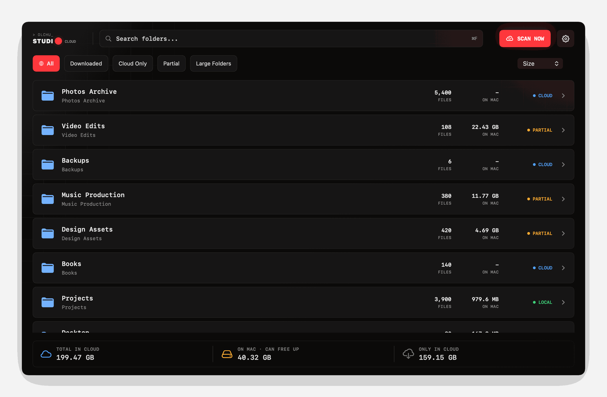
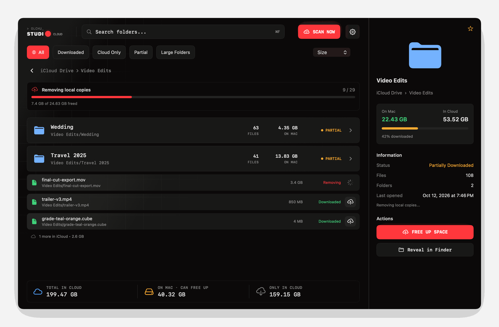

<p align="center">
  
</p>

<p align="center">
  
  
  
  
  <a href="LICENSE"></a>
</p>

**CloudeRm** shows how much space iCloud Drive takes on your Mac, folder by folder, and lets you remove the local copies you don't need. The files stay in iCloud and download again the moment you open them, exactly like Finder's **Remove Download**, but for whole folders at once and with a clear picture of where the space went.

---

## Why

With *Optimize Mac Storage* on, macOS decides on its own what stays downloaded. With it off, everything stays on the Mac. Neither tells you that `Video Edits` quietly holds 22 GB on disk while `Photos Archive` is already cloud-only.

CloudeRm answers three questions at a glance:

- **What is in iCloud?** The total size of every folder, including files that live only in the cloud.
- **What is on this Mac?** How much of each folder is downloaded right now.
- **What can I free up?** One click per folder, with progress, and nothing is ever deleted from iCloud.

## Screenshots

<p align="center">
  
</p>

<p align="center"><em>Every folder with its file count, size on this Mac, and state: <b>Local</b>, <b>Partial</b>, or <b>Cloud</b>.</em></p>

<p align="center">
  
</p>

<p align="center"><em>Drill into any folder, free it up, and keep queueing more while the progress bar runs.</em></p>

<sub>Screenshots are rendered from the real app with made-up sample data.</sub>

## Features

- **Fast scan straight from disk.** Reads file attributes in bulk with `getattrlistbulk` and the APFS *dataless* flag instead of asking the iCloud daemon about every file, which is far faster on large drives. Nothing gets downloaded while scanning.
- **Folder breakdown.** Size in iCloud, size on this Mac, file and folder counts, last modification, and a download percentage for every folder, including folders that are entirely cloud-only.
- **Filter, sort, search.** Show only *Downloaded*, *Cloud Only*, *Partial* or *Large Folders*; sort by size, name, date or file count; search by folder name or path.
- **Free up space safely.** Remove local copies of a whole folder or of single files. Removals run in a queue with a progress bar and a running total of freed space, and you can add more folders while it works.
- **Understands documents.** Packages such as `.pages`, `.key` or `.logicx` count as single items, just as iCloud treats them.
- **Spots unsynced files.** Reports local files inside iCloud Drive that iCloud doesn't sync (e.g. `.tmp`, `Thumbs.db`); they can't be freed this way.
- **Instant start.** The last scan is cached and shown immediately on launch; *Scan Now* refreshes it.
- **Full Scan fallback.** A slower scan through `FileManager` that relies only on iCloud's own resource values, for folders the fast scan can't read.

## Is it safe?

CloudeRm never deletes files. Freeing up space calls [`FileManager.evictUbiquitousItem(at:)`](https://developer.apple.com/documentation/foundation/filemanager/1409696-evictubiquitousitem), the same system API behind Finder's *Remove Download*. Before each removal it re-checks that the item:

- is an iCloud item, not a regular local file;
- is not currently downloading;
- still has a local copy.

Anything that fails a check is skipped and reported. The app is sandboxed, can access only the folder you choose, makes no network requests, and collects no data.

> [!NOTE]
> Removed files download again when you open them, and macOS may re-download files on its own if an app needs them.

## Requirements

- macOS 26.5 or later
- iCloud Drive turned on
- Xcode 26 or later to build from source

## Installation

There are no prebuilt releases yet; build it from source:

```sh
git clone https://github.com/olchu/CloudRm.git
cd CloudRm
open CloudeRm.xcodeproj
```

Select your team under **Signing & Capabilities**, then press **⌘R**.

### Build a DMG

```sh
scripts/build_dmg.sh
```

This builds a Release archive and packs it into `build/CloudeRm-<version>.dmg`. Signed with an *Apple Development* certificate, the DMG runs only on your own Macs. To notarize it for any Mac, see the comments at the top of [`scripts/build_dmg.sh`](scripts/build_dmg.sh); this needs a *Developer ID Application* certificate.

## Usage

1. Click **Analyze iCloud Drive**, or pick a specific folder with **⚙︎ → Choose Folder**.
2. Browse folders, sorted by size by default. Use the filters to find *Partial* or *Large Folders*.
3. Open a folder and click **Free Up Space**, or use the upload button next to a single file.
4. Watch the progress bar. Freed files leave the list, and their size moves to *Only in Cloud*.

## How it works

| File | Role |
| --- | --- |
| [`CloudFileDiskScanner.swift`](CloudeRm/CloudFileDiskScanner.swift) | Fast scanner. Walks directories on a pool of worker threads with `getattrlistbulk`, turns off dataless-file materialization so nothing downloads, and sums per-folder totals. |
| [`CloudFileScanner.swift`](CloudeRm/CloudFileScanner.swift) | Full Scan fallback using `FileManager.enumerator` and iCloud resource values. |
| [`CloudFileEvictor.swift`](CloudeRm/CloudFileEvictor.swift) | Validates each item and calls `evictUbiquitousItem(at:)`. |
| [`CloudFilesViewModel.swift`](CloudeRm/CloudFilesViewModel.swift) | Scan and eviction state, the eviction queue, and the folder summaries computed off the main thread. |
| [`CloudFileCache.swift`](CloudeRm/CloudFileCache.swift) | Remembers the last folder (security-scoped bookmark) and caches the last scan. |
| [`FileAccess.swift`](CloudeRm/FileAccess.swift) | Folder picker and security-scoped access. |
| [`ContentView.swift`](CloudeRm/ContentView.swift) | The SwiftUI interface (not MIT-licensed, see [License](#license)). |

### Regenerating the README images

```sh
scripts/readme-images/render.sh
```

This compiles the app's views together with [`RenderReadmeImages.swift`](scripts/readme-images/RenderReadmeImages.swift), renders the banner and both screenshots from fixed sample data into `docs/images`, and compresses the screenshots when Pillow is installed.

## Contributing

Issues and pull requests are welcome. Please keep changes focused, and check that the project builds with:

```sh
xcodebuild -project CloudeRm.xcodeproj -scheme CloudeRm -configuration Debug CODE_SIGNING_ALLOWED=NO build
```

## License

The source code is released under the [MIT License](LICENSE), with these exceptions:

- [`CloudeRm/ContentView.swift`](CloudeRm/ContentView.swift), the app's user interface;
- the CloudeRm name and app icon;
- the Olchu Studio logo;
- the app's visual design;
- the images in `docs/images`.

These are © 2026 olchu, all rights reserved. Forks are welcome to use the scanning and eviction code, but need their own interface, name and icon; see [NOTICE.md](NOTICE.md).
